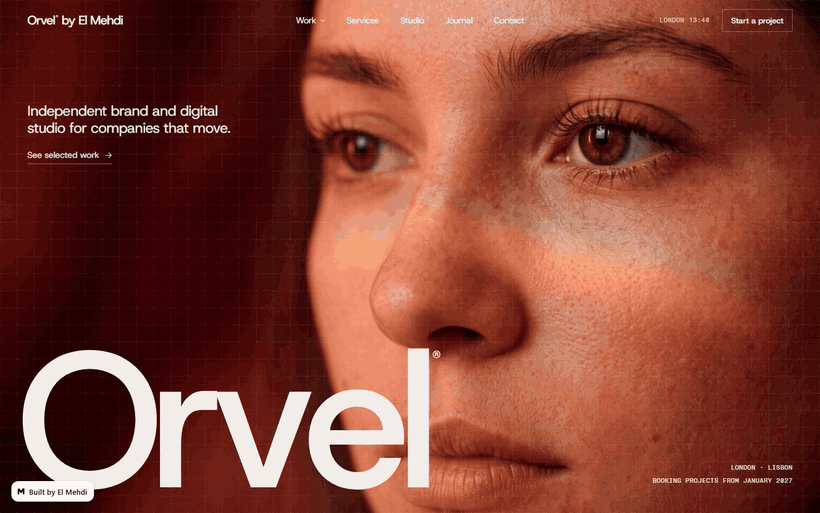
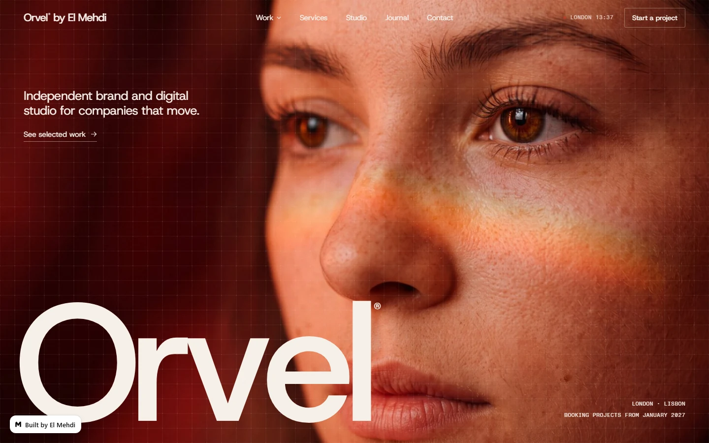
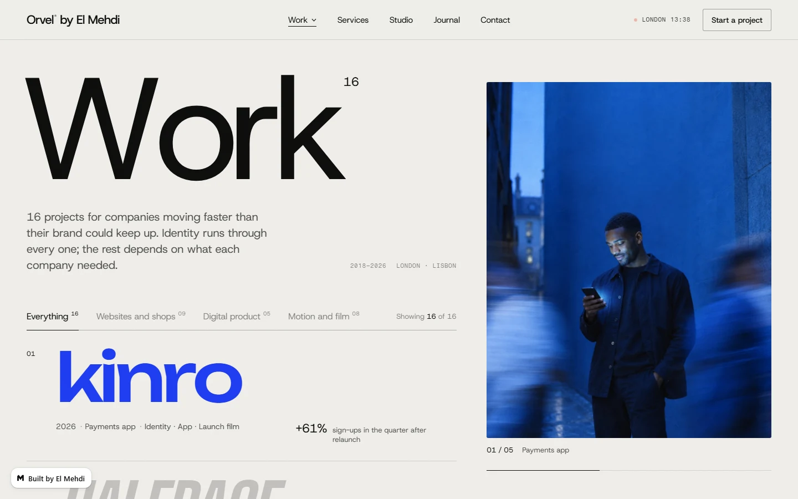
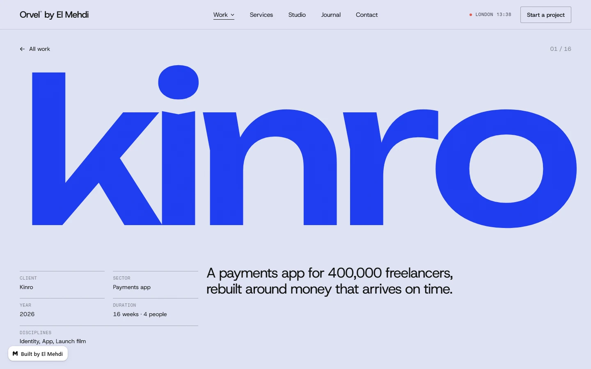
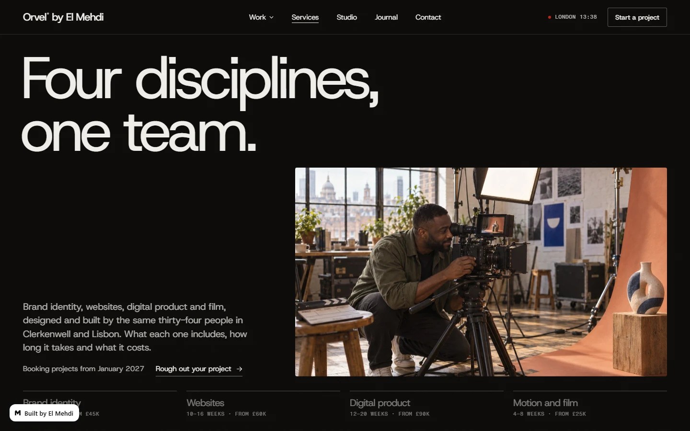
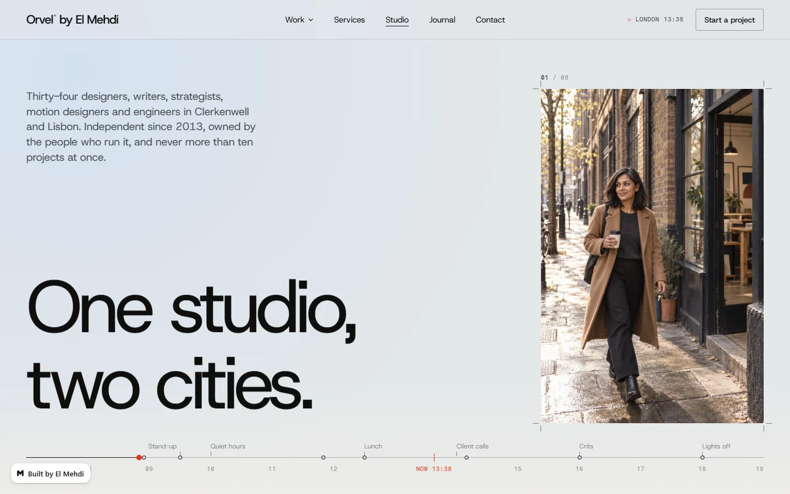
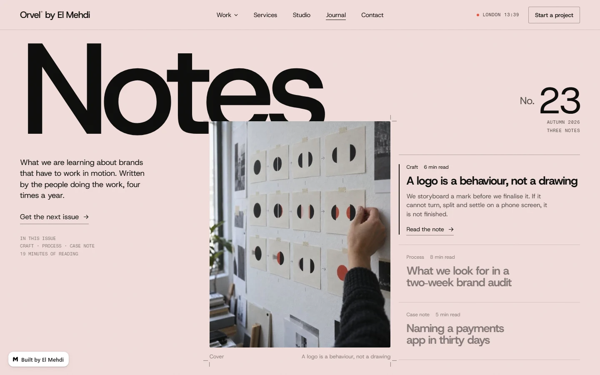
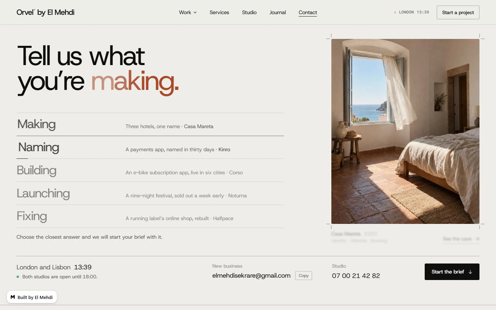
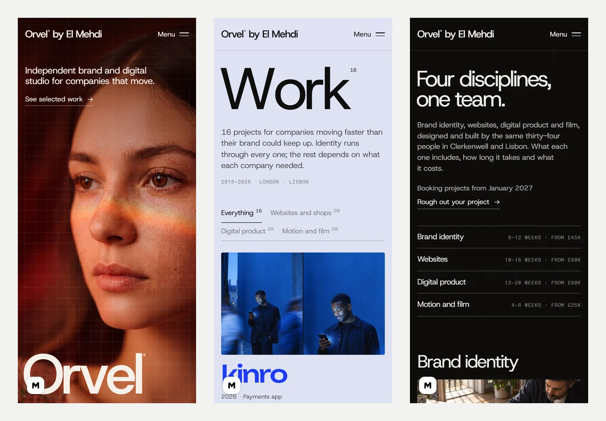

<div align="center">

# Orvel<sup>®</sup> by El Mehdi

### A brand and digital studio website: work, services, studio, journal and contact

53 static pages with page-transition covers, smooth scrolling, a scroll-driven showreel and 16 case studies,<br>
each one set in its client's own typeface. Responsive, self-hosted assets, deployed on Netlify.

[](https://orvel-by-elmehdi.netlify.app/)


<br>

<a href="https://orvel-by-elmehdi.netlify.app/"></a>

</div>

<br>

## ✦ Highlights

- **Page-transition covers**: clicking a link drops a full-screen card in the next page's colour and title, which lifts away once the page is ready
- **Scroll-driven showreel**: a 22-second reel starts as a small clip inside the headline and grows as you scroll; a full-screen player with sound opens on click (540p on phones, 720p on desktop)
- **16 case studies, 16 typefaces**: each case study and its transition cover use that client's own font (Unbounded, Fraunces, Bodoni, Syne…), all self-hosted
- **Work index with filters**: Everything / Websites and shops / Digital product / Motion and film, with live counts
- **Motion details**: Lenis smooth scrolling, a custom cursor, a WebGL image "dissolve" effect, a live London clock and text that fills in as you read, with `prefers-reduced-motion` support
- **Contact brief**: a step-by-step "tell us what you're making" form with inline validation and a "Copy address" button
- **Journal**: 30 articles with reading time, categories and article structured data
- **Fast static hosting**: no server code, immutable caching for hashed assets, a custom 404 page and `/x` → `/x/` redirects

<br>

## ✦ Screenshots

<table>
  <tr>
    <td width="50%"><p align="center"><b>Home</b>: full-bleed hero</p></td>
    <td width="50%"><p align="center"><b>Work</b>: 16 projects with filters</p></td>
  </tr>
  <tr>
    <td width="50%"><p align="center"><b>Case study</b>: Kinro</p></td>
    <td width="50%"><p align="center"><b>Services</b>: four disciplines with timings and prices</p></td>
  </tr>
  <tr>
    <td width="50%"><p align="center"><b>Studio</b>: London and Lisbon</p></td>
    <td width="50%"><p align="center"><b>Journal</b>: notes from the studio</p></td>
  </tr>
  <tr>
    <td width="50%"><p align="center"><b>Contact</b>: the project brief</p></td>
    <td width="50%"></td>
  </tr>
</table>

### On phone

<p align="center"></p>

<br>

## ✦ Pages

| Route | Page |
|---|---|
| `/` | Home: hero, studio intro with the showreel, selected work deck, services, testimonials, journal, contact call-out |
| `/work/` | Work index (16 projects, filterable) |
| `/work/<project>/` | 16 case studies: Kinro, Halfpace, Casa Mareta, Noturna, Vulca, Corso, Fontela, Clausa, Halyard Press, Greenwold, Torno, Ouvi, Polcarrow, Kestle, Casa da Estampa, Hollin |
| `/services/` | Brand identity, websites, digital product, motion and film |
| `/studio/` | The studio, team, the two cities, open roles |
| `/journal/` and `/journal/<note>/` | Journal index and 30 notes |
| `/contact/` | Project brief form, email and phone |
| `/privacy/` | Privacy policy |
| any other URL | Custom 404 page |

<br>

## ✦ Stack

| | |
|---|---|
| **Frontend** | Static HTML + CSS + JavaScript built with Astro (hashed bundles in `site/_astro/`), Lenis smooth scroll, WebGL for image effects |
| **Assets** | Self-hosted WOFF2 fonts (Host Grotesk, Fragment Mono, Instrument Serif + 16 case-study faces), responsive JPGs, H.264 showreel |
| **Hosting** | Netlify (static, no build step), security and cache headers in `netlify.toml` |

Based on the **Orvel** website template by [Visuvate](https://visuvate.com/), customised with my own details, photo, showreel and branding.

<br>

## ✦ Getting started

Needs only Node.js 18+ (no dependencies to install).

```bash
git clone https://github.com/elmehdi-sekrare/orvel-brand.git
cd orvel-brand
npm start    # → http://localhost:5321
```

`scripts/serve.mjs` follows the same rules as Netlify: `/work` → `/work/`, missing pages → `404.html`, byte ranges for video.

<br>

## ✦ Deploy

1. Netlify → **Add new site → Import an existing project** → pick this repo.
2. Leave the build settings as they are: `netlify.toml` already sets **publish directory `site`** and no build command.
3. **Deploy**. Every push to `main` redeploys.

The contact form has no backend: it validates and shows a thank-you screen in the browser. To receive messages, connect Netlify Forms or an API.

<br>

## ✦ Project structure

```
orvel-brand/
├── site/                 # the website, served as is
│   ├── index.html        # home
│   ├── work/             # work index + 16 case studies
│   ├── services/ studio/ journal/ contact/ privacy/
│   ├── 404.html          # not-found page
│   ├── _astro/           # hashed CSS + JS bundles
│   ├── fonts/            # self-hosted WOFF2 fonts
│   ├── img/  og/         # photos, tiles, share images
│   └── video/            # showreel (540p / 720p) + poster
├── scripts/serve.mjs     # local preview server (Netlify rules)
├── docs/                 # README images
├── netlify.toml          # publish dir + headers
└── package.json          # npm start
```

<br>

## ✦ Contact

**El Mehdi Sekrare**: web developer, Mohammedia, Morocco

[](https://www.linkedin.com/in/el-mehdi-sekrare-77000629b)
[](mailto:elmehdisekrare@gmail.com)
[](https://github.com/elmehdi-sekrare)
